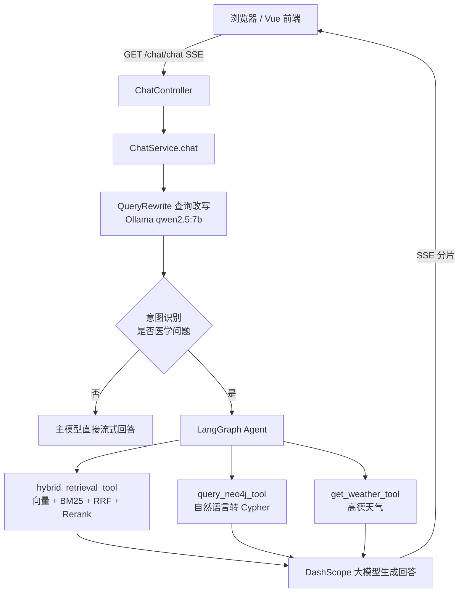

# 智能医疗 RAG 助手（Intelligent Medical RAG Assistant）

基于 **RAG + Agent + 知识图谱** 的医疗问答系统。支持医学知识混合检索、疾病实体关系查询、查询改写与意图识别，并带有历史会话管理与邮箱验证码登录。

> 本系统仅用于医学知识科普与技术学习，**不提供诊断、处方或用药建议**，不能替代执业医师意见

---

## 一、功能特性
| 模块 | 说明 |
| --- | --- |
| 智能问答 | 基于知识库的流式（SSE）回答，逐字返回 |
| 混合检索 | 向量语义检索 + BM25 关键词检索 + RRF 融合 + Reranker 重排序 |
| 意图识别 | 小模型判断是否属于医学问题，非医学问题直接走通用对话，避免无效检索 |
| 查询改写 | 结合历史对话对口语化/错别字/指代不清的问题做规范化改写 |
| Agent 工具调用 | 基于 LangGraph `create_agent`，按问题自动选择检索工具、图谱工具、天气工具 |
| 知识图谱 | Neo4j 存储「疾病-症状-药物-检查-科室-食物」等实体关系，支持自然语言转 Cypher 查询 |
| 会话管理 | 历史记录查询、续聊、重命名、删除 |
| 用户认证 | 邮箱验证码登录，JWT 鉴权，Token 存 Redis，支持退出登录 |
| 前端界面 | Vue3 + Element Plus，登录页 + 聊天页，Markdown 渲染、代码高亮 |

## 二、技术栈
 
- **前端**：Vue 3、Vite、Vue Router、Element Plus、Axios、markdown-it + highlight.js
- **后端**：Python 3.12、FastAPI、Uvicorn、LangChain / LangGraph
- **检索**：Chroma（向量库）、rank-bm25、FlagEmbedding（BGE Reranker）
- **模型**：阿里云百炼 DashScope（`ChatOpenAI` 兼容模式）作为主对话模型；Ollama + qwen2.5:7b 作为意图识别/查询改写的轻量模型；`bge-base-zh-v1.5` 做文本向量化
- **存储**：MySQL（用户与会话）、Redis（验证码与 JWT）、Neo4j（医疗知识图谱）
- **第三方服务**：SMTP 邮件（验证码）、高德开放平台（天气）

## 三、目录结构

```
IntelligentMedicalRAGAssistant/
├── medical_app/          # 前端：Vue3 + Vite（开发端口 8080）
│   ├── src/components/   # Login.vue 登录页、Chat.vue 聊天页
│   ├── src/router/       # 路由：/login、/chat
│   ├── nginx.conf        # 生产部署用 Nginx 配置
│   └── vite.config.js
├── angentic_medical/     # 后端（Agent 版，推荐运行此版本）
│   ├── main.py           # FastAPI 入口，注册 /users /chat /history
│   ├── common/           # 公共层：LLM/Embedding 加载、向量库、MySQL、分词
│   ├── users/
│   │   ├── agent/        # Agent 与工具：混合检索、Neo4j、天气
│   │   ├── controller/   # 接口层
│   │   ├── service/      # 业务层（ChatService 编排 RAG/Agent 流程）
│   │   ├── dao/          # 数据访问层（MySQL / Redis）
│   │   ├── entity/       # 实体定义
│   │   └── utils/        # BM25、RRF、Rerank、JWT、意图识别、日志、Neo4j
│   ├── Dockerfile
│   └── .env / .env.docker
├── medical_fastapi/      # 后端（基础 RAG 版，LangChain 链式实现，无 Agent）
│   ├── create_datas/     # 向量库构建脚本（medical.json → Chroma）
│   ├── medical_datasets/ # 原始数据 medical.json 与生成的向量库（向量库已 gitignore）
│   └── ...
└── 医疗助手流程图v1/v2.jpg
```

> `medical_fastapi` 与 `angentic_medical` 是同一系统的两个演进阶段：前者用 LangChain `RunnableParallel | prompt | llm` 固定链路完成「意图识别 → 混合检索 → 重排 → 生成」；后者在其基础上引入 LangGraph Agent 与工具调用，可按问题类型动态选择检索、图谱或天气工具。**新功能建议在 `angentic_medical` 上开发。**

## 四、请求流程



## 五、快速开始

### 1. 环境要求

- Python 3.12+
- Node.js 18+
- MySQL 8、Redis、Neo4j（可选，仅图谱工具需要）
- Ollama（本地部署 `qwen2.5:7b`，用于意图识别与查询改写）

### 2. 准备本地模型

RAG 流程依赖两个本地模型：

| 用途 | 模型 | 默认路径（代码中配置） |
| --- | --- | --- |
| 文本向量化 | `bge-base-zh-v1.5` | 由环境变量 `EMBEDDING_MODEL_PATH` 指定 |
| 重排序 | `bge-reranker-base` | `users/utils/Rerank.py` 中硬编码为 `/models/bge-reranker-base` |

> 在 Windows 本地运行时，需要把 `Rerank.py` 里的路径改成你本地的实际路径（例如 `D:\models\bge-reranker-base`）。

### 3. 初始化数据库

MySQL 中需存在以下两张表（依据 DAO 中的 SQL 整理，请按实际库结构核对）：

```sql
CREATE DATABASE IF NOT EXISTS feifan_two DEFAULT CHARSET utf8mb4;

CREATE TABLE users (
    users_id  INT PRIMARY KEY AUTO_INCREMENT,
    user_name VARCHAR(64)  NOT NULL,
    email     VARCHAR(128) NOT NULL UNIQUE
);

CREATE TABLE history (
    history_id  INT PRIMARY KEY AUTO_INCREMENT,
    username    VARCHAR(64)  NOT NULL,
    question    TEXT,
    answer      TEXT,
    parent_id   INT DEFAULT 0,   -- 0 表示新会话的首轮，其余为续聊
    create_time DATETIME,
    INDEX idx_username (username),
    INDEX idx_parent (parent_id)
);
```

### 4. 构建向量库（首次运行）

`medical_fastapi/create_datas/MedicalDataBuild.py` 会把 `medical_datasets/medical.json` 按 180 字切分（overlap 30）写入 Chroma 集合 `medical_datas`。该脚本内路径为绝对路径，运行前请改成自己的目录。

### 5. 配置环境变量

在 `angentic_medical/` 下创建 `.env`（可参考 `.env.docker` 的字段），所有配置项如下：

| 变量 | 说明 |
| --- | --- |
| `SENDER_EMAIL` / `SENDER_EMAIL_PASSWORD` | 发件邮箱与 SMTP 授权码 |
| `SMTP_HOST` / `SMTP_PORT` | 邮件服务器地址与端口 |
| `MYSQL_HOST` / `MYSQL_PORT` / `MYSQL_USER` / `MYSQL_PASSWORD` / `MYSQL_DATABASE` / `MYSQL_CHARSET` | MySQL 连接信息 |
| `REDIS_HOST` / `REDIS_PORT` / `REDIS_DB` | Redis 连接信息 |
| `CHROMA_PERSIST_DIRECTORY` | Chroma 向量库持久化目录 |
| `EMBEDDING_MODEL_PATH` | `bge-base-zh-v1.5` 本地路径 |
| `OLLAMA_BASE_URL` / `OLLAMA_MODEL_NAME` | Ollama 服务地址与模型名 |
| `DASHSCOPE_API_KEY` / `DASHSCOPE_MODEL_NAME` | 阿里云百炼 API Key 与主模型名 |
| `SECRET_KEY` / `ALGORITHM` / `ACCESS_TOKEN_EXPIRE_MINUTES` | JWT 密钥、算法与过期时间 |
| `NEO4J_URL` / `NEO4J_USERNAME` / `NEO4J_PASSWORD` / `NEO4J_DATABASE` | Neo4j 连接信息（`--host.docker.internal:7687` 等仅容器场景有效） |

> 天气工具的高德 API Key 目前硬编码在 `users/agent/weather_tool.py`，也建议迁到环境变量。

### 6. 启动后端

```bash
cd angentic_medical
python -m venv .venv

# Windows
.venv\Scripts\activate
# Linux / macOS
source .venv/bin/activate

pip install -r requirements.txt
python main.py          # 访问 http://localhost:8000/docs
```

### 7. 启动前端

```bash
cd medical_app
npm install
npm run dev             # http://localhost:8080
```

前端 Axios 的 `baseURL` 与 SSE 地址均硬编码为 `http://localhost:8000`（见 `src/main.js` 与 `src/components/Chat.vue`），部署到其他地址时需同步修改。

## 六、接口一览

| 方法 | 路径 | 说明 |
| --- | --- | --- |
| GET | `/users/sendEmail?email=` | 发送 4 位登录验证码（60 秒有效，存入 Redis） |
| GET | `/users/checkCode?email=&code=` | 校验验证码并签发 JWT |
| GET | `/chat/chat?question=&historyId=&token=` | 流式问答（SSE，`text/event-stream`，以 `[END]` 结束） |
| POST | `/chat/saveChatHistory` | 保存问答记录，返回新的 `historyId` |
| GET | `/history/findChatHistory` | 查询当前用户全部会话列表 |
| GET | `/history/clickOneConversation?historyId=` | 查询某会话完整对话内容 |
| DELETE | `/history/deleteChatHistory?historyId=` | 删除某会话 |
| PUT | `/history/renameConversation?historyId=&newTitle=` | 重命名会话 |
| DELETE | `/history/logout` | 退出登录（删除 Redis 中的 Token） |

鉴权方式：请求头 `Authorization: Bearer <token>`；`/chat/chat` 因使用 `EventSource`，改为通过查询参数传 `token`。

## 七、Docker 部署

`angentic_medical` 提供了多阶段构建的 `Dockerfile`（python:3.12.14，非 root 用户运行，健康检查为 `/docs`）：

```bash
cd angentic_medical
docker build -t medical-rag-backend .

docker run -d --name medical-rag \
  -p 8000:8000 \
  --env-file .env.docker \
  -v /your/models:/models \
  -v /your/vectorstore:/data/medical_datas \
  medical-rag-backend
```

容器内路径依赖：`EMBEDDING_MODEL_PATH=/models/bge-base-zh-v1.5`、`CHROMA_PERSIST_DIRECTORY=/data/medical_datas`，与 `Rerank.py` 中的 `/models/bge-reranker-base` 需一并挂载。前端可执行 `npm run build` 后用 `medical_app/nginx.conf` 托管。

## 八、注意事项

1. **凭据安全**：仓库历史中的 `.env`、`.env.docker` 内含明文 SMTP 授权码、数据库口令、JWT 密钥与 DashScope API Key。若该目录曾提交或分享过，请**立即轮换全部密钥**，并将敏感值改为从环境变量注入。
2. **硬编码路径**：`Rerank.py`、`MedicalDataBuild.py` 使用绝对路径，跨平台运行前需调整。
3. **CORS 白名单**：后端仅允许 `http://localhost:8080`，修改前端端口时需同步 `main.py`。
4. **开发模式**：`main.py` 中 `reload=True` 仅适用于开发，上线应改为 `False` 并用 Gunicorn/Uvicorn Worker 部署。
5. **流式接口**：`/chat/chat` 为 GET + SSE，浏览器 `EventSource` 不支持自定义请求头，因此 Token 走查询参数，注意日志脱敏。
